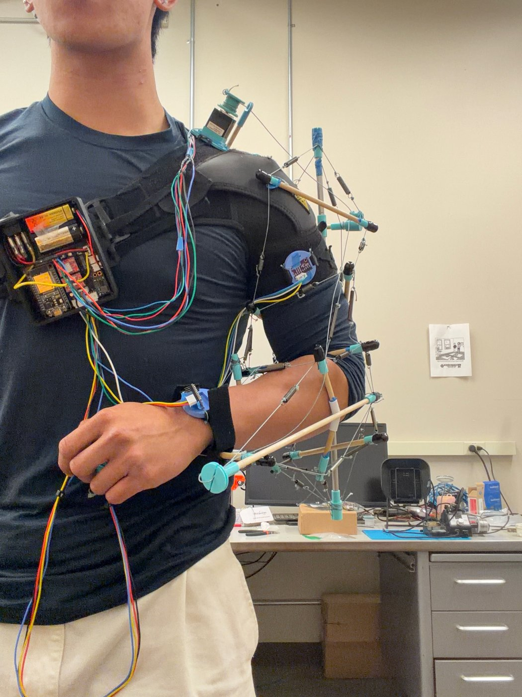
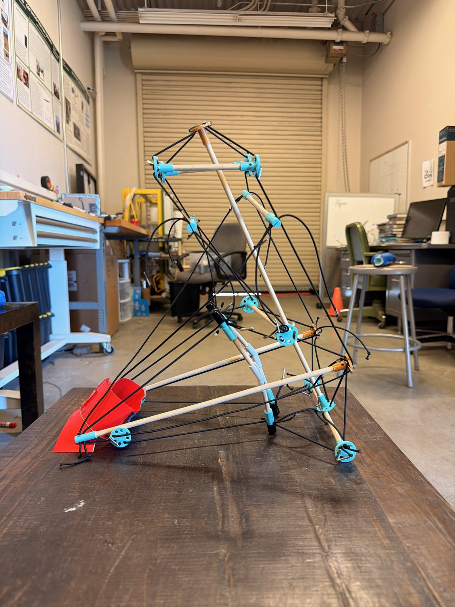
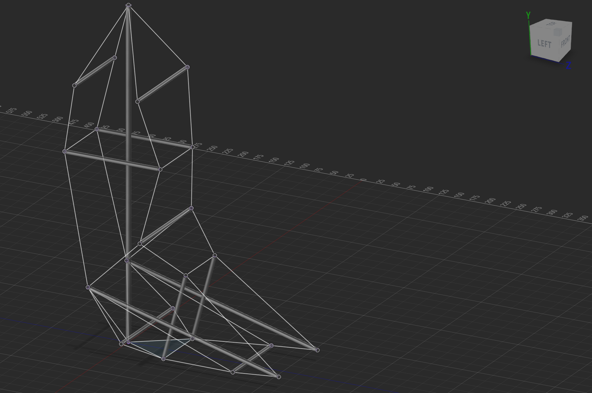

# Feedback Control of an Upper-Limb Tensegrity Exoskeleton

Research by **Vincent Le**, advised by **Dr. Alan Zhang**, Department of Mechanical Engineering, Cal Poly San Luis Obispo. Built during the **2026 Summer Undergraduate Research Program (SURP)**.

Most upper-limb exoskeletons make you pick a tradeoff: rigid frames are heavy and restrictive, and cable systems usually need a big external frame or a bulky pack of motors and batteries. I wanted to see if a tensegrity structure (rods held together by cables and springs, closer to how bones and muscles actually work) could give real elbow assistance while staying light and compliant.

Over about 40 lab days I took an inherited tensegrity arm, rebuilt it to actually fit on a person, and turned it into a working electromechanical system: two stepper-driven cable spools on the shoulder, two BNO085 IMUs on the upper arm and forearm, an ESP32 running a 100 Hz state machine, and a custom PCB I designed in KiCad and had fabricated.

**What works:** both IMUs stream reliably, the firmware turns them into an elbow angle, and the motors follow the arm and trigger an assist when the arm stalls mid-curl. **What doesn't (yet):** the motors are too weak. With a 5 lb dumbbell the system stalled, and test participants didn't feel meaningful lifting help. This is a proof of concept for the sensing and control loop, not a finished assistive device.


### Start here (2-minute tour)

| If you want to see... | Look at |
| --- | --- |
| The control logic | [`firmware/controller/src/controller.cpp`](firmware/controller/src/controller.cpp): the follow / assist / release state machine |
| IMU packet parsing and elbow-angle math | [`firmware/controller/src/imu.cpp`](firmware/controller/src/imu.cpp) |
| The PCB | [`hardware/electronics/pcb-v1`](hardware/electronics/pcb-v1) (KiCad + Gerbers for the fabricated Rev A board) and the [layout image](results/figures/photos/pcb-layout.png) |
| How it all came together | [Build log](docs/build-log.md) |
| The research poster | [Poster preview](results/poster/source-and-previews/finalposter.jpg) |

## What I built

| Area | Details |
| --- | --- |
| **Mechanical** | Redesigned the tensegrity arm around my own arm, then designed and printed the parts: spools, fairleads, motor and IMU mounts, an electronics enclosure, and many iterations of rod caps. I swapped about 40 elastic cables for tuned string-and-spring pairs and added a shoulder harness so it can be worn. |
| **Sensing** | Two BNO085 IMUs in UART-RVC mode, each on its own ESP32 UART. The firmware validates every 19-byte packet with a checksum, converts each IMU to a quaternion, and takes the relative rotation as the elbow angle. |
| **Control** | A 100 Hz state machine (disabled, calibrating, follow, assist, release, fault). In follow, the spools keep the cables just slack as the arm moves. If the arm dips while held up (a stall), it switches to assist and winds the cable, then releases when motion resumes, the arm is lowered, or a time limit is hit. Includes filtering, a deadband, travel limits, sensor-loss shutdown, and a manual stop switch. |
| **Electronics** | Prototyped on a breadboard, then a perfboard, then designed a 2-layer PCB (Rev A, fabricated through OSH Park): socketed ESP32 and A4988 stepper drivers, JST-XH connectors for the IMUs and motors, a Mini360 buck converter, an optional XT30 LiPo input, sized power traces, and an antenna keep-out. ERC and DRC clean. |
| **Testing** | Dual-IMU angle validation on my arm and a rigid dummy arm, spool and cable-travel measurement, six IMU controller trials, and an EMG pilot comparing baseline and assisted lifts. |

### Problems I had to solve

- **I2C kept failing on the IMUs.** After a full day of isolating hardware, swapping boards and checking every connection with a multimeter, the clone IMU boards just wouldn't stay on the I2C bus. I switched both IMUs to UART-RVC on separate ESP32 ports, wrote a packet decoder, and both have streamed reliably since. Independent channels also mean one bad sensor can't take down the bus.
- **The perfboard broke.** The ESP32's USB connector snapped off, and with everything soldered down it wasn't worth repairing. That's what pushed me to design the PCB with socketed, swappable parts.
- **The angle reads low at large flexion.** Validation showed it's accurate up to about 45° but underestimates by roughly 17 to 20° near 90 to 120°. The controller is calibrated against that (a measured 83° corresponds to a physical 100°), and fixing it properly is on the next-steps list.
- **The motors are underpowered.** Each spool gives about 56.5 mm of cable per revolution and needs 200 to 220 mm to go from 0 to 100°. The steppers can do that, but they can't hold a real load. The next revision needs more torque.

## Key results

**Elbow angle validation** (100 samples per point, neutral-relative quaternion method):

| Actual angle | Measured, worn on arm | Measured, rigid dummy arm |
| ---: | ---: | ---: |
| ~0° | 1.6° | 0.7° |
| ~45° | 33.2° | 44.6° |
| ~90° | 75.7° | 72.7° |
| ~120° | 99.7° | 101.2° |
| back to ~0° | 10.9° | 19.7° |

Readings rise consistently with flexion, which is good enough for feedback control, but the return-to-zero offset and the high-angle underestimate still need work.

**Motion trials:** six recorded controller trials show the IMUs tracking motion and the controller switching into assist. Participants didn't notice real lifting help. The EMG pilot wasn't clean enough (timing drift, uneven recording intervals) to say whether muscle effort went down. Details are in [limitations](results/limitations.md).

## Build photos

| Worn prototype | Electronics enclosure | PCB layout (KiCad) |
| --- | --- | --- |
|  |  |  |

| Tensegrity frame | CAD assembly |
| --- | --- |
|  |  |

## Explore the research

| Area | Contents |
| --- | --- |
| [Firmware](firmware/README.md) | Current controller, independent loggers, calibration, and sensor examples |
| [Hardware](hardware/README.md) | Mechanical component designs, cable calculations, and two PCB revisions |
| EMG experiment | Raw Shimmer recordings are kept private; processing code is in [analysis](analysis/README.md) and figures in [results](results/README.md) |
| [IMU experiment](experiments/imu-controller-demo/README.md) | Six controller recordings and per-trial analysis |
| [Analysis](analysis/README.md) | Python acquisition and plotting, MATLAB processing, and legacy methods |
| [Results](results/README.md) | Figures, poster preview, and limits on interpretation |
| [Methods](docs/methods.md) | Experiment separation, provenance, and measurement definitions |
| [Build log](docs/build-log.md) | How the prototype came together, condensed from my lab notebook |

## Repository layout

```text
firmware/       Independent PlatformIO projects and calibration
hardware/       Mechanical components and electronics revisions
experiments/    Original data, derived tables, protocols, and metadata
analysis/       Acquisition and analysis code
results/        Figures and poster previews
docs/           Research question, methods, and build log
archive/        Original wiring and hardware notes
```

This public repository is a curated copy of the research archive. Raw EMG recordings, large poster originals, inherited CAD, and restricted third-party files are kept private.

## Reproduce the IMU analysis

From the repository root, use Python 3 in a virtual environment:

```sh
python3 -m venv .venv
source .venv/bin/activate
python -m pip install -r analysis/requirements.txt
python analysis/imu/analyze_imu.py --output analysis/reproduced/imu
```

The script reads the six original IMU CSVs by default. It produces per-trial summaries, combined derived data, figures, notes, and a bundle. Reproduction outputs stay separate from the imported historical results.

The EMG pipeline is `analysis/emg/process_all_emg.m` (MATLAB). The raw EMG spreadsheets it reads are not published, so it is included for reference. See the [analysis guide](analysis/README.md).

## Build firmware

Open one folder containing `platformio.ini` in PlatformIO, or run:

```sh
pio run -d firmware/controller
```

The default target is `esp32dev`. Each logger is a separate project; do not combine their `setup()` and `loop()` entry points. Build checks do not establish physical hardware behavior. Wiring and historical hardware details are preserved in the [earlier firmware documentation](archive/documentation/README-before-research-organization.md).

## Next steps

If I keep going, the priorities are stronger actuation (higher-torque motors and better cable pretension), measuring actual cable force instead of inferring it from motor steps, fixing the angle offset, and running synchronized IMU and EMG trials with a standard movement protocol.

## Detailed findings

The six IMU recordings document motion sensing and controller activation; participant notes report no noticeable lifting assistance. EMG export timing, signal drift, and inconsistent recording intervals prevent a reliable conclusion about reduced muscle effort. Relative IMU angle and emitted motor pulses are proxies, not independently validated anatomical angle or measured torque.

See [limitations](results/limitations.md).

## Sharing and attribution

Thanks to Dr. Alan Zhang for advising the project, Israel Villegas, whose earlier tensegrity arm was my starting point, and Robert, who helped assemble and debug the Rev A board. Tom Flemons' tensegrity arm models were a big influence on the structure.

Published with the approval of the research advisor. Hardware files in `hardware/` are the author's own designs; inherited and vendor files are excluded, and no license is assigned to third-party work.
