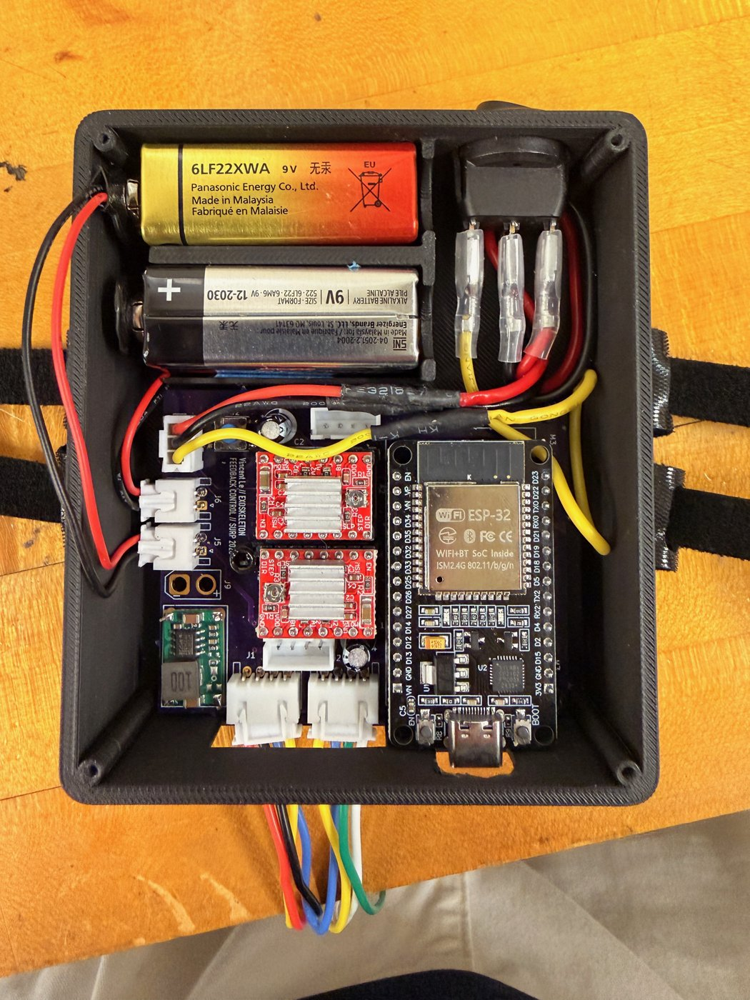
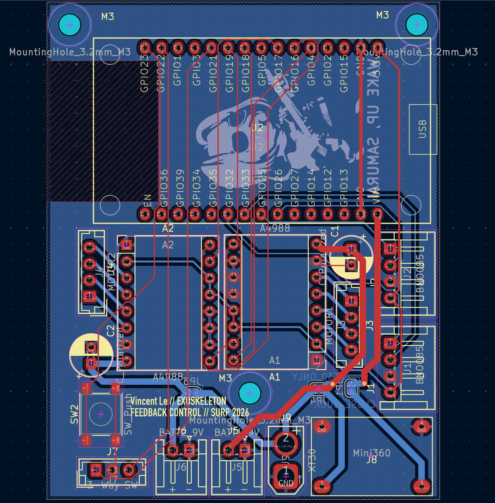

 
# Feedback Control of an Upper Limb Tensegrity Exoskeleton

Research by **Vincent Le**, advised by **Dr. Alan Zhang**, Department of Mechanical Engineering, California Polytechnic State University, San Luis Obispo. Developed during the **2026 Summer Undergraduate Research Program**, with earlier ME 400 project work preserved as background.

This project investigates whether a wearable, tensegrity-inspired upper-limb system can use IMU feedback to control cable actuation and provide measurable elbow assistance. It combines an ESP32 controller, two BNO085 IMUs, stepper-driven spools, custom electronics, and redesigned mechanical components.

The prototype demonstrates integrated sensing, motor commands, and controller activation. **Effective physical assistance and reduced muscle effort have not been established.** The EMG and IMU recordings are separate pilot studies with important measurement limitations.


## Build photos

| Worn prototype | Electronics enclosure | PCB layout (KiCad) |
| --- | --- | --- |
|  |  |  |

| Tensegrity frame | CAD assembly |
| --- | --- |
|  |  |

## Explore the research

| Area | Contents |
| --- | --- |
| [Firmware](firmware/README.md) | Current controller, independent loggers, calibration, and sensor examples |
| [Hardware](hardware/README.md) | Mechanical component designs, cable calculations, and two PCB revisions |
| EMG experiment | Raw Shimmer recordings are kept private; processing code is in [analysis](analysis/README.md) and figures in [results](results/README.md) |
| [IMU experiment](experiments/imu-controller-demo/README.md) | Six controller recordings, raw serial logs, and per-trial analysis |
| [Analysis](analysis/README.md) | Python acquisition and plotting, MATLAB processing, and legacy methods |
| [Results](results/README.md) | Figures, poster preview, and limits on interpretation |
| [Methods](docs/methods.md) | Experiment separation, provenance, and measurement definitions |
| [Development history](docs/development-log.md) | Project stages and preserved historical firmware |

## Repository layout

```text
firmware/       Independent PlatformIO projects and calibration
hardware/       Mechanical components and electronics revisions
experiments/    Original data, derived tables, protocols, and metadata
analysis/       Acquisition and analysis code
results/        Figures and poster previews
docs/           Methods and development history
archive/        Original wiring and hardware notes
```

This public repository is a curated copy of the research archive. Raw EMG recordings, large poster originals, inherited CAD, and restricted third-party files are kept private.

## Reproduce the IMU analysis

From the repository root, use Python 3 in a virtual environment:

```sh
python3 -m venv .venv
source .venv/bin/activate
python -m pip install -r analysis/requirements.txt
python analysis/imu/analyze_imu.py --output analysis/reproduced/imu
```

The script reads the six original IMU CSVs by default. It produces per-trial summaries, combined derived data, figures, notes, and a bundle. Reproduction outputs stay separate from the imported historical results.

The EMG pipeline is `analysis/emg/process_all_emg.m` (MATLAB). The raw EMG spreadsheets it reads are not published, so it is included for reference. See the [analysis guide](analysis/README.md).

## Build firmware

Open one folder containing `platformio.ini` in PlatformIO, or run:

```sh
pio run -d firmware/controller
```

The default target is `esp32dev`. Each logger is a separate project; do not combine their `setup()` and `loop()` entry points. Build checks do not establish physical hardware behavior. Wiring and historical hardware details are preserved in the [earlier firmware documentation](archive/documentation/README-before-research-organization.md).

## Research findings and next steps

The six IMU recordings document motion sensing and controller activation; participant notes report no noticeable lifting assistance. EMG export timing, signal drift, and inconsistent recording intervals prevent a reliable conclusion about reduced muscle effort. Relative IMU angle and emitted motor pulses are proxies, not independently validated anatomical angle or measured torque.

Next steps include measuring cable force, improving actuation and pretension, validating angle estimates, and collecting synchronized trials with verified EMG acquisition settings and standardized movement intervals. See [limitations](results/limitations.md).

## Sharing and attribution

Published with the approval of the research advisor. Hardware files in `hardware/` are the author's own designs; inherited and vendor files are excluded, and no license is assigned to third-party work.
